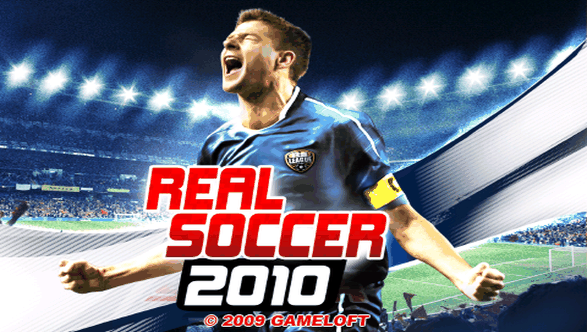

<h1 align="center">
  <br>
  Real Soccer 2010 · PS Vita Port
</h1>

<p align="center">
  <a href="#-status--playability">Status & Playability</a> •
  <a href="#setup-instructions-for-players">How to install</a> •
  <a href="#controls">Controls</a> •
  <a href="#known-issues">Known Issues</a> •
  <a href="#build-instructions-for-developers">How to compile</a> •
  <a href="#credits--acknowledgments">Credits</a>
</p>

An unofficial, native **iOS-to-PS Vita wrapper port** of *Real Soccer 2010* (originally developed by **Gameloft**, iPhone, 2009). There is no `.so` here: this port ships its own **Mach-O loader** and **Objective-C runtime** that map the official armv6 iOS executable (`RSoccer10`, from the 1.1.0 IPA) into PS Vita RAM and replace the Apple frameworks it uses (Foundation, UIKit, CoreFoundation, AudioToolbox, OpenAL, OpenGL ES, GameKit) with native implementations on top of **vitaGL**, **openal-soft**, **libvorbis** and the Vita system libraries.

---

## 🎮 Status & Playability

**Status: PLAYABLE (beta) (v1.0)**

On physical PlayStation Vita hardware the game boots to the main menu, and friendly matches can be played from kick-off with music, sound effects and physical controls.

- [x] **Mach-O loader**: loads the armv6 executable at a fixed base (`MACHO_SLIDE = 0x98000000`), applies **29,256** rebase words, resolves **1,488** import slots (0 unimplemented), runs the **8** global constructors, and enters the game. *Verified on console.*
- [x] **Graphics**: GLES 1.x → **vitaGL** (`SOFTFP_ABI=1`). The game runs as an iPhone (480×320, landscape) and is shown at 816×544 with side borders, keeping the aspect ratio. Menus, the 3D team screens and matches render. *Verified on console.*
- [x] **Audio**: sound effects through OpenAL and music through AudioQueue (the IPA's `.m4a` tracks converted to `.ogg`). *Verified on console.*
- [x] **Touch & Controls**: front touchscreen as the iPhone screen; the left stick drives the in-match virtual pad and the physical buttons press the on-screen pass / shoot / back buttons (see [Controls](#controls)). *Verified on console.*
- [x] **Saves**: iOS `Documents/` is redirected to `ux0:data/realsoccer10/Documents/`.
- [x] **Performance**: the game's own 30 fps timer; matches run at roughly 25–30 fps with dips in busy scenes. *Verified on console.*
- [x] **Offline bypasses**: GameKit multiplayer is stubbed and the "More games" (IGP) menu entry is disabled.
- [ ] **One-frame flashes during matches**: fixed in this build (corrupt player matrices are dropped), not yet confirmed on console.
- [ ] **Trophies**: not implemented.

---

## Disclaimer

**Real Soccer** is a registered trademark of **Gameloft**. The work presented in this repository is unofficial and is not produced, endorsed, or sanctioned by Gameloft or any affiliated entities.

This software does NOT contain original game code, binaries, copyrighted graphics, or game assets. The authors do not promote or condone piracy in any way. To play, you must provide your own legally obtained, **decrypted** copy of the iOS `.ipa`.

---

## Setup Instructions (For Players)

1. **CFW & Plugins**: PS Vita on Custom Firmware (**Enso 3.60 / 3.65** recommended) with `kubridge` under `*KERNEL` in `ur0:tai/config.txt`:
   ```ini
   *KERNEL
   ur0:tai/kubridge.skprx
   ```
2. **Shader Compiler**: `libshacccg.suprx` must be in `ur0:data/` (extract it with **ShaRKBR33D**).
3. **Game Files**: a decrypted **Real Soccer 2010 1.1.0** iOS `.ipa` (FairPlay `cryptid 0`). Open it as a ZIP and extract `Payload/RSoccer10.app/`. Other versions will not match `rebase.bin`.
4. **Music**: convert the four `.m4a` tracks of the `.app` to `.ogg` with the same name (without this the game runs silent of music), e.g.:
   ```bash
   for f in RSoccer10.app/*.m4a; do ffmpeg -i "$f" -vn -ac 2 -c:a vorbis -strict -2 -q:a 5 "${f%.*}.ogg"; done
   ```
5. **Copy to the Vita** (`ux0:data/realsoccer10/`):
   ```
   ux0:data/realsoccer10/
     game_app/      the contents of RSoccer10.app (plus the .ogg files), renamed to game_app
     rebase.bin     from the release
     binds.bin      from the release
     nib.txt        from the release
     controls.txt   from the release — button mapping, editable over FTP
     Documents/     created automatically — your save games
     logs/          created automatically — realsoccer10_001.log … one per run
   ```
6. **Install VPK**: install `realsoccer10.vpk` with VitaShell.

---

## Controls

Physical buttons are translated into touches on the game's own on-screen buttons. The touch points can be edited in `ux0:data/realsoccer10/controls.txt` (coordinates on the 480×320 screen) without recompiling.

| Input | Action | Status |
| :---: | :--- | :---: |
| **Front Touchscreen** | iPhone touch screen (menus, HUD) | ✅ Working |
| **Left Stick / D-Pad** | Move the player (virtual pad) and phone tilt | ✅ Working |
| **Cross (✖)** | B — shoot | ✅ Working |
| **Square (◼)** | A — pass | ✅ Working |
| **Circle (●)** | Back | ✅ Working |
| **Triangle (▲) / R** | Top-right match buttons | ✅ Working |
| **Start** | Tap the screen center | ✅ Working |
| **L** | Shake the phone (throw-in) | ⚠️ Not confirmed |

> [!TIP]
> **Throw-in**: aim by holding the left stick fully to one side (phone tilt), then press **L** to throw. Hold **Select + Start** for 2 seconds to cycle the picture rotation if it shows upside down (saved in `rotation.txt`).

---

## Known Issues

- **Flashes during matches**: before this build, a player's model could stretch over the screen for one frame (Gameloft's fixed-point skinning overflows). The fix drops those draws; it has not been confirmed on console yet.
- **Frame rate dips**: some match scenes drop to 10–15 fps.
- **Spotlights**: vitaGL does not implement `GL_SPOT_*`, so the game's spotlight parameters are ignored.
- **Intro video** (`.m4v`) is skipped.
- **Ball trajectory**: a rare ball bounce overflowed its 300-frame path and crashed the match; it is clamped by a patch, but the source of the extreme ball speed is unknown.
- **Online features disabled**: GameKit/Bluetooth multiplayer is stubbed, "More games" does nothing, and Gameloft Live is not functional.
- **Crash dumps** are written by the system to `ux0:data/` (not to the game folder).

---

## Build Instructions (For Developers)

### Prerequisites

- [VitaSDK](https://vitasdk.org/) (`$VITASDK`, softfp) with `vitashark`, `openal-soft`, `libvorbis`, `mathneon`, `freetype`, `libpng`, `zlib` and `bzip2`; `vitaGL` is vendored and built with `SOFTFP_ABI=1`.
- CMake 3.14+, Python 3 (for the tools), `ffmpeg` (music conversion).
- The decrypted `RSoccer10.app` folder, linked as `game_app` in the repo root (never committed).

### Compilation Commands

```bash
git clone https://github.com/MetalSyntax/Real-Soccer-2010-vita.git
cd Real-Soccer-2010-vita
ln -s /path/to/Payload/RSoccer10.app game_app

# Stage the console data: copies the .app, generates rebase.bin / binds.bin / nib.txt, converts music to .ogg
tools/stage_data.sh

# Build eboot.bin / realsoccer10.vpk
cmake -S . -B build
cmake --build build
```

### Deploy & Debug (over VitaShell FTP)

```bash
python3 -I tools/deploy_data.py          # incremental upload of ux0_data/realsoccer10/
python3 -I tools/deploy_data.py --logs   # fetch logs and crash dumps into ./logs/
```

A crash PC in `0x98xxxxxx` minus `0x98000000` is the address in the Mach-O (look it up with `python3 -I tools/annotate.py`). A data address below `0x02000000` means a missing rebase (see `report.txt` from `tools/ios_prep.py`). Architecture and progress notes: [`PORTING_PLAN.md`](PORTING_PLAN.md) and [`port_progress.md`](port_progress.md).

---

## ☕ Support My Work

This project is **free** and will stay free. If you enjoy it, a tip from **$1** helps me keep porting games to the PS Vita:

<p align="center">
  <a href="https://ko-fi.com/metalsyntax"></a>
</p>

- **Ko-fi:** [ko-fi.com/metalsyntax](https://ko-fi.com/metalsyntax)
- **PayPal:** [paypal.me/MetalSyntax](https://paypal.me/MetalSyntax)
- **Bitcoin (BTC):** `133HdCsaWxdjTfmwpgGVykByhNBV338uRc`

**Ko-fi supporters get:**
- **Early access** to new ports before their public release (test builds of upcoming projects).
- **Data preparation scripts and step-by-step guides** to set up your own game files for each new port.
- A say in which games I port next.

> Game files are never distributed. You always need your own legally obtained copy of the game.

---

## Credits & Acknowledgments

- **Real Soccer 2010** is intellectual property of **Gameloft**.
- **vitaGL** graphics library by [Rinnegatamante](https://github.com/Rinnegatamante/vitaGL).
- **kubridge** plugin by [Bythos](https://github.com/bythos14/kubridge).
- **openal-soft**, **libvorbis**, **FreeType**, **libpng** and **zlib** projects.
- The **iOS Mach-O loader** is based on [`ios-loader-boilerplate`](https://github.com/MetalSyntax/ios-loader-boilerplate) and [`Inotia2-vita`](https://github.com/MetalSyntax/Inotia2-vita); gameplay fixes shared with [`Real-Soccer-2009-vita`](https://github.com/MetalSyntax/Real-Soccer-2009-vita).
- Special thanks to the PS Vita homebrew and porting community.
